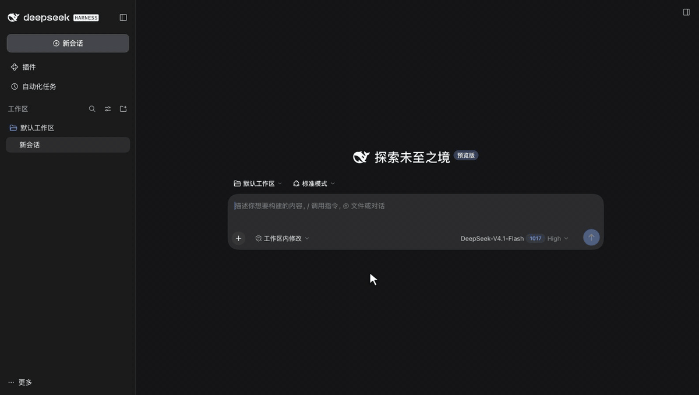
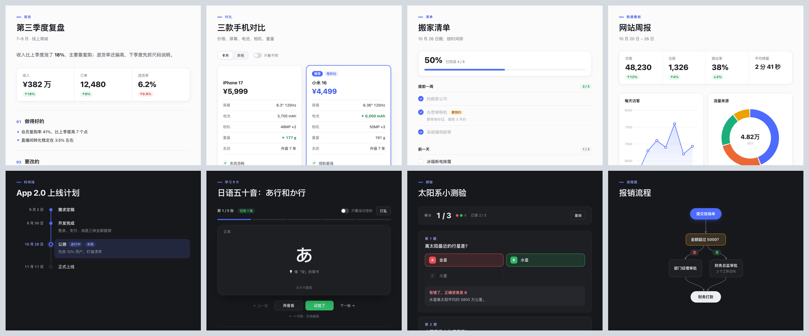
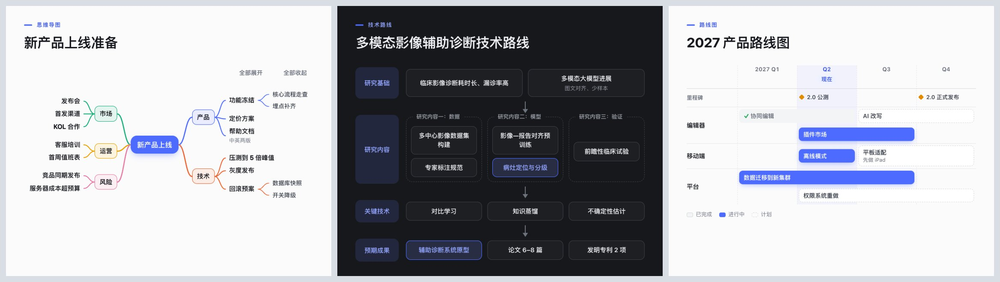

<div align="center">



<p>
  <a href="https://github.com/OrderG-X/dsh-pages/releases"></a>
  
  <a href="https://github.com/awesome-dsh-plugin/awesome-dsh-plugin"></a>
</p>

<p>
  <a href="README.md">简体中文</a> ·
  <a href="README.en.md"><b>English</b></a>
</p>

</div>



Let the model in DSH (DeepSeek Harness) turn an answer into a web page: comparisons, checklists, charts, calculators, quizzes... The page is **embedded right under the reply** and works as is. It follows DSH's light/dark theme, and whatever you filled in is still there when you reopen it. Every edit is saved as a new version, and old ones stay one click away. The right sidebar shows the full page, and one click exports PNG / PDF / HTML.

Common page types (reports, comparisons, checklists, dashboards, timelines, flashcards, quizzes, flowcharts, mind maps, roadmaps) have **ready-made templates**: the model writes only the content, and the plugin handles layout and interaction. It is fast, saves tokens and doesn't break. The model writes a full web page only when no template fits.

> **In one line:** a DeepSeek Harness (DSH) plugin. The model uses `show_page` to turn an answer into a page that shows right in the chat and is interactive. The 10 common templates need content only. Pages follow light/dark, have versions, are checked automatically after saving, and can be exported.
>
> **Use it for:** "Make that into a page", "Build me a mortgage calculator", "Compare these three phones" — whenever a page is clearer than a paragraph of text.
>
> **Install:** on the DSH Plugins page, click Add plugin and enter `@orderg-x/dsh-pages` (an npm package; if npm can't be reached it switches to a mirror in China automatically), then restart DSH.

## Install

On the DSH Plugins page, click Add plugin and enter the package name:

```
@orderg-x/dsh-pages
```

This is an npm package. When you install by package name and DSH can't reach the official npm registry, it switches to a mirror in China (npmmirror) automatically, without going through GitHub. You can also enter the release package URL `https://github.com/OrderG-X/dsh-pages/releases/latest/download/dsh-pages.tgz`, but then GitHub must be reachable.

**Restart DSH** after installing (the client code is bundled when DSH starts, so the pages won't show up until you restart). The plugin appears as "Pages" on the DSH Plugins page.

**Updating:** on DSH 0.2.2 or later, open it on the Plugins page and click "Update to …". On older DSH, uninstall it and add it again as above. A new version can be installed about a day after release, because the pnpm that DSH uses skips brand-new versions by default. To get it right away, uninstall it and add the release tarball instead (a tarball install can't use Update later).

For development you can link a local directory: enter this repo's absolute path in Add plugin. It installs as `link:`, and code changes also need a restart.

## What it looks like

1. **While writing:** a skeleton card appears in the tool group: "Writing the page… 12.0 KB written".
2. **When done:** the page is embedded right under the reply, already at the height of its content (measured during the check, so it doesn't jump). If it is too tall it starts collapsed; click "Expand" to see all of it. For long reports the model can choose to show just a thumbnail card.
3. **Right sidebar:** click "Open on the right" to see the full page. At the top you can flip between versions (‹ v2 / 3 ›), export, and refresh. "‹ All pages" lists every page you've made, with thumbnails. The "+" in the right sidebar also has a "My pages" entry.
4. **Edit again:** say "make the title bigger", and the model calls the tool again with the `page_id`, saving v2. In the chat, earlier turns still show v1 and new turns show v2.
5. **My pages:** with many pages you can search by title. To remove one, click "×" then "Delete?", and the whole page moves to the trash (`~/.dsh/dsh-pages/trash/`; move it back into `pages/` to restore it).
6. **On your phone** (with [dsh-mobile](https://github.com/OrderG-X/dsh-mobile)): pages are still embedded in the chat, and the title bar buttons shorten automatically. "Open on the right" fills the whole screen.

## Templates





The model passes `template` and `data` (content only), and the plugin lays out the page: colors, light/dark, phone layout, interaction and saving are all built in. This is much faster than having the model write a whole web page from scratch, and it doesn't break. If `data` is wrong, the tool says exactly what is wrong, and the model fixes it.

All templates share one design: a short blue line and a small category label above the title; big numbers as the stars; a single accent color (DeepSeek blue), with green, red and amber meaning only good, bad and watch out; panels are white with a thin border, and lists are separated by thin lines. Chart colors are picked in an order that stays distinguishable for color-blind users.

When a template doesn't fit and the model writes a full HTML page itself (calculators, small games, unusual layouts), the same design is applied on save: headings, body text, tables, buttons and inputs look like this without any styling of their own, and ready-made color variables and classes for headers, panels, big numbers, inputs and switches are available (the tool description lists them for the model). This stylesheet lives in a CSS `@layer`, so the page's own styles always win and nothing gets broken.

| Template | Good for | What you can do on the page |
| --- | --- | --- |
| `report` | Reviews, research, summaries | Summary, metric cards, sections (text / list / table / callout), sources |
| `compare` | Choosing a phone or a plan | Switch between cards and table, "Differences only", best value marked automatically (higher or lower is better), recommended item highlighted |
| `checklist` | To-dos, trips, moving | Ticks saved automatically, progress bar, "Hide done", reset |
| `dashboard` | Weekly reports, sales, traffic | Metric cards with up/down change, bar / line / donut charts (drawn by the plugin, no external library), hover to see values |
| `timeline` | Plans, history, progress | Done / in progress / not started |
| `flashcards` | Vocabulary, concepts | Click a card to flip it, "Got it" counter, show only the ones you haven't got, shuffle |
| `quiz` | Self-tests, making questions | Click to see right or wrong, with explanation and score, retry |
| `flow` | Approvals, step-by-step procedures | Layers laid out automatically, branches, cross-layer and backward connectors routed around each other |
| `mindmap` | Sorting out ideas, reading notes, knowledge structure | Center in the middle with branches to both sides; falls back to one side, then to a vertical outline on phones; click a node to fold it (remembered), expand / collapse all; a Markdown outline works too |
| `roadmap` | Technical routes for grant proposals and theses, product / project roadmaps | Two styles: top-down stages (stage names on the left, dashed groups, arrows between layers or one connector per link); time-based swimlanes (overlapping items wrap to a new row, milestones, the current period marked, scrolls sideways when there are many periods) |

Text can use `**bold**`, `` `code` ``, and `[links](https://…)`. Button text on the page follows the language of the content (Chinese / English).

## Light and dark

- Cards and the right sidebar use DSH's own design variables, so they follow DSH.
- The page itself switches too, **without reloading** (filled-in forms and dragged sliders stay as they are). When the page is sent out, a small script is added that sets `data-theme="light|dark"`, `data-bs-theme`, `.dark` and `color-scheme` on `<html>`. Your own variables, Tailwind, DaisyUI and Bootstrap all pick it up.
- A `@media (prefers-color-scheme: dark)` written in the page is also changed to follow DSH (if DSH is set to dark and the system is light, the page still goes dark).
- Pages the model writes itself come with the light/dark variables of the design above (`--bg` `--surface` `--fg` `--muted` `--line` `--accent` and so on). Use them and the page switches automatically.

## Pages can store things

In the sandbox, touching `localStorage` / `sessionStorage` / cookies / IndexedDB normally throws an error and the whole page crashes. The plugin replaces them with working versions:

- `localStorage` is stored in DSH per page: how many to-dos you ticked, the numbers you typed into a calculator. They are still there after you reopen DSH or the model makes a new version. Each page can store up to about 250,000 characters.
- If the same page is open in the chat and in the right sidebar at once: a page that listens to the `storage` event follows the other side as soon as it changes. A page that doesn't listen reloads in full to the new content when the mouse moves back to the other side (so the old copy never overwrites what was just changed).
- `sessionStorage` lasts only for this opening; cookies read as empty; IndexedDB is treated as unavailable.

## Automatic check

After saving, the page is opened in an invisible Chrome / Edge on your machine (with the same sandbox as in the chat). It takes a second or two, and the result goes to the model together with the tool result:

- Script errors, libraries that fail to load from the CDN, requests blocked by the sandbox
- Blank page
- Horizontal overflow at chat width (720px) and phone width (390px), naming the element
- A light background in dark mode
- Embedding it the way the chat does and measuring the embedded height; pages that use 100vh plus margins and keep growing are called out

For anything blocked by the sandbox, the message says how to fix it (for example "the page can't fetch data over the network, write the data into the page directly"), and the model just follows it.

If there are problems, the model fixes them and calls the tool again; if there are none, no more checking is needed. It also grabs a light and a dark thumbnail for "My pages". If Chrome / Edge isn't installed, the check is skipped.

## Usage

| Parameter | Required | Description |
| --- | --- | --- |
| `title` | Yes | Page title, keep it short |
| `template` | One of the two | Use a template: `report` / `compare` / `checklist` / `dashboard` / `timeline` / `flashcards` / `quiz` / `flow` / `mindmap` / `roadmap`, together with `data` |
| `data` | With a template | The template's content (JSON). Each template's fields are in the tool description; for examples see `test/fixtures/template-samples.mjs` |
| `html` | One of the two | Without a template: a complete, self-contained HTML page; write styles and scripts in the page, and libraries can be loaded from cdn.jsdelivr.net / cdnjs.cloudflare.com / unpkg.com |
| `page_id` | No | To edit an existing page, pass the `page_id` returned last time; it is saved as a new version |
| `display` | No | `inline` (default, embedded in the chat) or `card` (only a thumbnail card; click to open it on the right) |

## Security

- **Pages are locked in a sandbox:** the response header carries `Content-Security-Policy: sandbox allow-scripts …`, so the page runs in an opaque origin and can't reach DSH's APIs or cookies. `connect-src 'none'` means no fetch / XHR / WebSocket. Images, audio and video accept only `data:` / `blob:` (icons can be loaded from the three CDNs), so a page can't build an image URL out of what the user typed and send it out. Scripts and styles can only be loaded from the three CDNs.
- **Pages that navigate away on their own:** during the check this is always blocked and the model is told. In the chat, a page that navigates away is pulled back to the original page. Still, a browser can't stop the navigation before it is sent, so don't type passwords or the like into a page.
- **Login required:** both the page and the APIs have their login checked by DSH's own `connection` service. Older DSH versions without that service accept only local connections and check Host / Sec-Fetch-Site / Origin (against DNS rebinding and cross-site requests).
- **APIs that change things** (export, show in folder, delete page, save page data) accept only JSON sent from the same origin. "Show in folder" only accepts files exported this time.
- **What a page stores** can only go into its own page (which page is decided by the chat outside, not by what the page says), only strings are accepted, with a size limit. It is escaped when sent back to the page, so a stored `</script>` can't break out. The small script is placed at the very start of the document, and a `<head>` written inside a comment can't fool it.
- **The headless browser used for the check** has none of DSH's cookies. Only when it gets a free slot and is really about to open the page is it given a token that is valid for one minute, works for that one page only, and accepts local connections only. If what loads isn't that page (token expired, page gone), the result is not recorded and no thumbnail is saved. The browser runs with `--remote-debugging-pipe` (no port opened), and the temporary user directory is deleted after use.
- **Stored files:** writes to the same page are queued, and there is a cross-process lock too (so the DSH desktop app and the command line editing the same page at once don't lose versions). `meta.json` is validated when read, version numbers must be positive integers, and a broken record doesn't take down the list. Page data is stored as "what changed", so two windows (a computer and a phone, say) each editing their own part don't wipe each other out; it is saved immediately when the page closes.

## Where it's stored

`~/.dsh/dsh-pages/pages/<page_id>/`: `meta.json` (title, versions, check results), `v1.html` (the HTML exactly as the model gave it), `v1.jpg` / `v1-dark.jpg` (thumbnails), `state.json` (the page's own localStorage). Deleted pages are in `~/.dsh/dsh-pages/trash/`. Exported files go to Downloads.

## Architecture

```
server   show_page ──save a version──▶ headless Chrome check (token load) ──▶ result + page_id + URL back to the model
routes   /dsh-pages/page?id=&v=&theme=   CSP sandbox · injects light/dark and height scripts
         /dsh-pages/api/{list,meta,thumb,export,reveal,delete,state}
client   turnTail slot (page / thumbnail card under the reply) · toolview slot (skeleton card while writing) · "Pages" tab in the right sidebar
```

- `lib/index.js` — tools, routes, gatekeeping, export
- `lib/design.js` — the shared design (color variables, base look, ready-made classes), used by templates and hand-written pages
- `lib/templates.js` — the 10 templates: content validation, layout, the small in-page interaction scripts
- `lib/store.js` — saving pages, versions and page data, deleting pages (writes to the same page are queued)
- `lib/runtime.js` — the small script injected into pages: light/dark, reporting height, opening external links in a new window, logging errors, a working localStorage
- `lib/check.js` — the check, full-page screenshots, saving PDF
- `lib/browser.js` — headless Chrome / Edge (CDP over a pipe, closed automatically when idle)
- `lib/client.js` — the client (`exports.inject` is the client **short service name**)
- `cordis.patch.yml` — bundle patch

## Tests

```sh
npm test                                          # server, client, templates, check (uses a real browser when Chrome / Edge is available)
node e2e/e2e-pages.mjs --dsh 0.2.1-rc.3 [--light] # installs a temporary DSH web build + a fake model + headless Chrome and runs the whole flow
```

## Verified

DeepSeek Harness 0.2.1-rc.2 through 0.2.2-rc.3: 35 end-to-end checks on a temporary DSH web build, run once in dark and once in light (the card while writing, embedded in the chat, height following content, light/dark switching without reload, the right sidebar, making v2 and flipping back to v1, exporting HTML / PNG, all pages with thumbnails, things ticked on a page still there after reopening DSH, live sync when open in two places, phone width, deleting a page into the trash, using templates). Each template was clicked through in a real browser (ticking, switching, flipping cards, answering, chart tooltips, flowchart connectors, folding mind map nodes, roadmap connectors and sideways scrolling), and all passed the check at 720 and 390 width, in light and dark; PDF export lays the page out at paper width, so connectors stay in place. Tested on the desktop app with DeepSeek-V4.1-Flash: for a checklist, a dashboard, a "learn Python from zero" mind map, an NSFC grant proposal technical route and a quarterly product roadmap it picked the right template by itself in one step; for a mortgage calculator, an income tax calculator and a trip cost-splitter written without a template, it used the same design, dark mode was handled, and the check passed.

## Feedback

Hit a problem or want a new feature? [Open an issue](https://github.com/OrderG-X/dsh-pages/issues/new/choose). When reporting a problem, include your DSH version and plugin version so it can be fixed faster.
