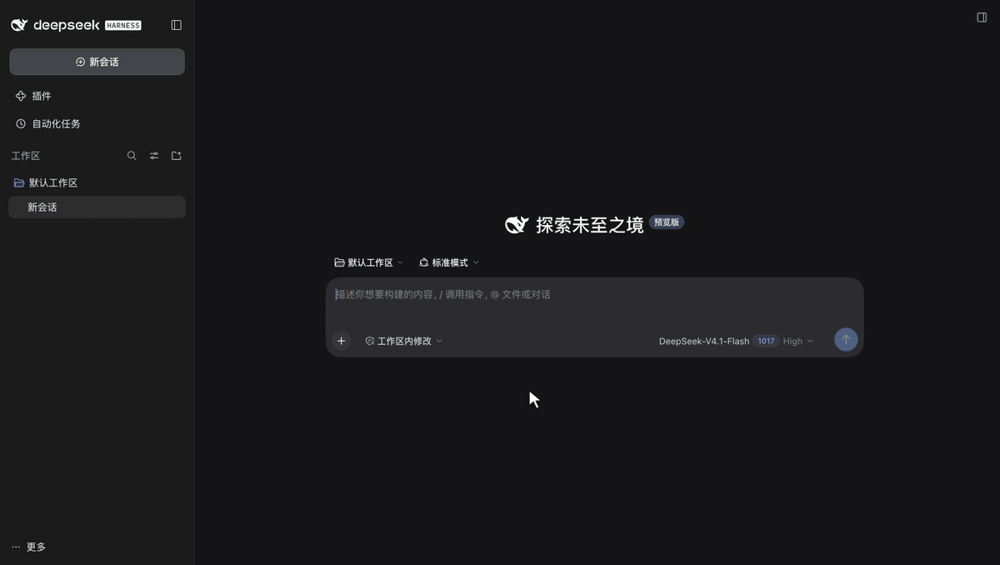

<div align="center">



<p>
  <a href="https://github.com/OrderG-X/dsh-pages/releases"></a>
  
  <a href="https://github.com/awesome-dsh-plugin/awesome-dsh-plugin"></a>
</p>

</div>



让 DSH（DeepSeek Harness）的模型把回答做成一页网页：对比、清单、图表、计算器、测验……页面**直接嵌在回复下面**，能点能用，深浅色跟着 DSH 走，填过的东西重开还在。改一次存一版，旧版留着能翻；右侧栏看整页，一键导出 PNG / PDF / HTML。

> **一句话**：DeepSeek Harness（DSH）插件，模型用 `show_page` 把回答做成一页，直接显示在对话里、能交互；跟随深浅色、有版本、存好自动体检、能导出。
>
> **什么时候用**：「做成一页给我看」「做个房贷计算器」「三款手机对比一下」——看一页比读一段字清楚的时候。
>
> **安装**：`dsh plugin add @orderg-x/dsh-pages`（npm 包），重启 DSH。
>
> **English:** a DeepSeek Harness (DSH) plugin. The model calls `show_page` to turn an answer into a web page that lives right in the chat: interactive, following DSH's light/dark theme, versioned (edit → v2, flip back anytime), checked automatically in a headless browser after saving, opened full-size in the right sidebar, and exported to PNG / PDF / HTML. Install with the command above, then restart DSH.

## 安装

```sh
dsh plugin add @orderg-x/dsh-pages
```

也可以直接装发布包：`dsh plugin add https://github.com/OrderG-X/dsh-pages/releases/latest/download/dsh-pages.tgz`。装完**重启 DSH**（客户端代码在 DSH 启动时打包，不重启看不到页面）。DSH「插件」页里显示为「页面」。

开发时可以直接链到本地目录：`dsh plugin --profile desktop add link:/path/to/dsh-pages`，改了代码同样要重启。

## 用起来是什么样

1. **写的时候**：工具组里先出一张骨架卡片，「正在写页面… 已写 12 KB」。
2. **写好了**：页面直接嵌在回复下面，一出来就是内容的高度（体检时量好了，不跳）；太高先收起，点「展开」看全。长报告类模型可以选只放一张缩略图卡片。
3. **右侧栏**：点「在右侧打开」看整页；顶上能翻版本（‹ v2 / 3 ›）、导出、刷新；「‹ 全部页面」是做过的所有页面（带缩略图）。右侧栏「+」里也有「我的页面」入口。
4. **再改**：说「把标题改大一点」，模型带上 `page_id` 再调一次，存成 v2。对话里旧回合还是 v1，新回合是 v2。
5. **我的页面**：页面多了能搜标题；不要的点「×」再点「确定删除？」，整页挪进回收站（`~/.dsh/dsh-pages/trash/`，挪回 `pages/` 就回来了）。
6. **手机上**（配合 [dsh-mobile](https://github.com/OrderG-X/dsh-mobile)）：页面照样嵌在对话里，标题栏按钮自动变短；「在右侧打开」铺满整屏。

## 深浅色

- 卡片、右侧栏用 DSH 自己的设计变量，跟着 DSH 走。
- 页面里也跟着换，**不重载**（填了的表单、拖过的滑块都还在）：页面送出去时塞一小段脚本，在 `<html>` 上设 `data-theme="light|dark"`、`data-bs-theme`、`.dark` 和 `color-scheme`，自己写的变量、Tailwind、DaisyUI、Bootstrap 都认。
- 页面里写的 `@media (prefers-color-scheme: dark)` 也改成听 DSH 的（DSH 选了深色、系统是浅色时照样变深）。
- 模型只给一段 HTML 时，套的外壳自带一套深浅色变量（`--fg` `--bg` `--card` `--line` `--accent`）。

## 页面能存东西

沙箱里本来一碰 `localStorage` / `sessionStorage` / cookie / IndexedDB 就报错，页面整个挂掉。插件换成了能用的：

- `localStorage` 按页面存进 DSH：待办勾了几项、计算器填的数，重开 DSH、模型改出新版本都还在。每页最多存 25 万字左右。
- 对话里和右侧栏同时开着同一页：页面听 `storage` 事件的，一边改了另一边马上跟上；不听的，鼠标移回另一边时整页重载成新的（旧的那份不会把刚改的盖掉）。
- `sessionStorage` 只在这次打开里有；cookie 读出来是空的；IndexedDB 当没有。

## 自动体检

存好就在本机一个看不见的 Chrome / Edge 里打开（和对话里一样的沙箱），一两秒出结果，跟工具结果一起交给模型：

- 脚本报错、库从 CDN 载不进来、被沙箱拦下的请求
- 空白页
- 对话宽度（720px）和手机宽度（390px）下横向溢出，指出是哪个元素
- 深色模式下背景还是浅色
- 照对话里的做法嵌一遍，量出嵌进去的高度；用了 100vh 又加边距、越撑越长的页面会指出来

被沙箱拦下的会说清楚该怎么改（比如「页面不能联网取数据，把数据直接写进页面」），模型照着改就行。

有问题模型会改了再调一次；没问题就不用再检查。顺手截深浅两张缩略图给「我的页面」用。没装 Chrome / Edge 时跳过体检。

## 用法

| 参数 | 必填 | 说明 |
| --- | --- | --- |
| `title` | 是 | 页面标题，短一点 |
| `html` | 是 | 完整、自包含的 HTML；样式脚本写在页面里，库可以从 cdn.jsdelivr.net / cdnjs.cloudflare.com / unpkg.com 引 |
| `page_id` | 否 | 改已有页面时填上次返回的 `page_id`，存成新版本 |
| `display` | 否 | `inline`（默认，嵌在对话里）或 `card`（只放缩略图卡片，点开在右侧看） |

## 安全

- **页面关在沙箱里**：回应头带 `Content-Security-Policy: sandbox allow-scripts …`，页面跑在不透明源里，碰不到 DSH 的接口和 cookie；`connect-src 'none'`，不能 fetch / XHR / WebSocket；图片、音视频只收 `data:` / `blob:`（图标可以从三个 CDN 拉），页面没法把用户填的东西拼进图片地址发出去。脚本和样式只能从三个 CDN 拉。
- **页面自己跳走**：体检时一律拦下并告诉模型；对话里的页面跳走了会被拉回原页面。不过浏览器没法在跳转发出去之前拦住它，所以别在页面里填密码一类的东西。
- **要登录态**：页面和接口都交给 DSH 自己的 `connection` 服务验登录；老版本 DSH 没有这个服务时只收本机连接，并查 Host / Sec-Fetch-Site / Origin（防 DNS 重绑定、跨站）。
- **改东西的接口**（导出、在文件夹里显示、删页面、存页面数据）只收同源发来的 JSON；「在文件夹里显示」只认这次导出过的文件。
- **页面存的东西**只能存进它自己那一页（哪一页由外面的对话决定，页面说了不算），只收字符串、有上限；送回页面时转义过，存进去的 `</script>` 跳不出来。小脚本塞在文档最前面，注释里写的 `<head>` 骗不了它。
- **体检用的无头浏览器**没有 DSH 的 cookie：排到空位、真要开页面时才给它一个一分钟有效、只认那一页、只收本机连接的口令；载进来的不是这一页（口令过期、页面没了）就不记结果、不存缩略图。浏览器走 `--remote-debugging-pipe`（不开端口），临时用户目录用完就删。
- **存的文件**：同一页的写入排队，还有一把跨进程的锁（DSH 桌面端和命令行同时改同一页也不会丢版本）；`meta.json` 读进来先校验，版本号只认正整数，坏掉的记录不拖垮列表。页面数据存的是「改了什么」，两个窗口（比如电脑和手机）各改各的不会互相抹掉；页面关掉时马上存。

## 存在哪

`~/.dsh/dsh-pages/pages/<page_id>/`：`meta.json`（标题、各版本、体检结果）、`v1.html`（模型给的原样 HTML）、`v1.jpg` / `v1-dark.jpg`（缩略图）、`state.json`（页面自己存的 localStorage）。删掉的在 `~/.dsh/dsh-pages/trash/`。导出的文件在「下载」里。

## 架构

```
服务端  show_page ──存一版──▶ 无头 Chrome 体检（口令载入）──▶ 结果 + page_id + 地址回给模型
路由    /dsh-pages/page?id=&v=&theme=   CSP 沙箱 · 塞深浅色 / 高度小脚本
        /dsh-pages/api/{list,meta,thumb,export,reveal,delete,state}
客户端  turnTail 槽（回复下方嵌页面 / 缩略图卡片）· toolview 槽（写的时候的骨架卡片）· 右侧栏「页面」标签
```

- `lib/index.js` —— 工具、路由、把门、导出
- `lib/store.js` —— 存页面、版本、页面数据，删页面（同一页的写入排队）
- `lib/runtime.js` —— 塞进页面的小脚本：深浅色、报高度、外部链接新窗口开、记报错、能用的 localStorage
- `lib/check.js` —— 体检、整页截图、存 PDF
- `lib/browser.js` —— 无头 Chrome / Edge（CDP 管道，闲置自动关）
- `lib/client.js` —— 客户端（`exports.inject` 是客户端**短服务名**）
- `cordis.patch.yml` —— bundle patch

## 测试

```sh
npm test                                          # 服务端、客户端、体检（有 Chrome / Edge 时用真浏览器）
node e2e/e2e-pages.mjs --dsh 0.2.1-rc.3 [--light] # 临时装一个 DSH 网页版 + 假模型 + 无头 Chrome，整套走一遍
```

## 已验证

DeepSeek Harness 0.2.1-rc.3：临时 DSH 网页版端到端 31 项，深色、浅色各跑一遍（写的时候的卡片、嵌在对话里、高度跟内容、深浅色切换不重载、右侧栏、改出 v2 和翻回 v1、导出 HTML / PNG、全部页面带缩略图、页面里勾的东西重开 DSH 还在、手机宽度、删页面挪进回收站）。桌面端用 DeepSeek-V4.1-Flash 实测：「做一个房贷计算器」一轮两步直接调 `show_page`，深色适配好，体检通过。

## 反馈

遇到问题或想要新功能，[提一个 issue](https://github.com/OrderG-X/dsh-pages/issues/new/choose)。报问题时写上 DSH 版本和插件版本，修起来最快。
